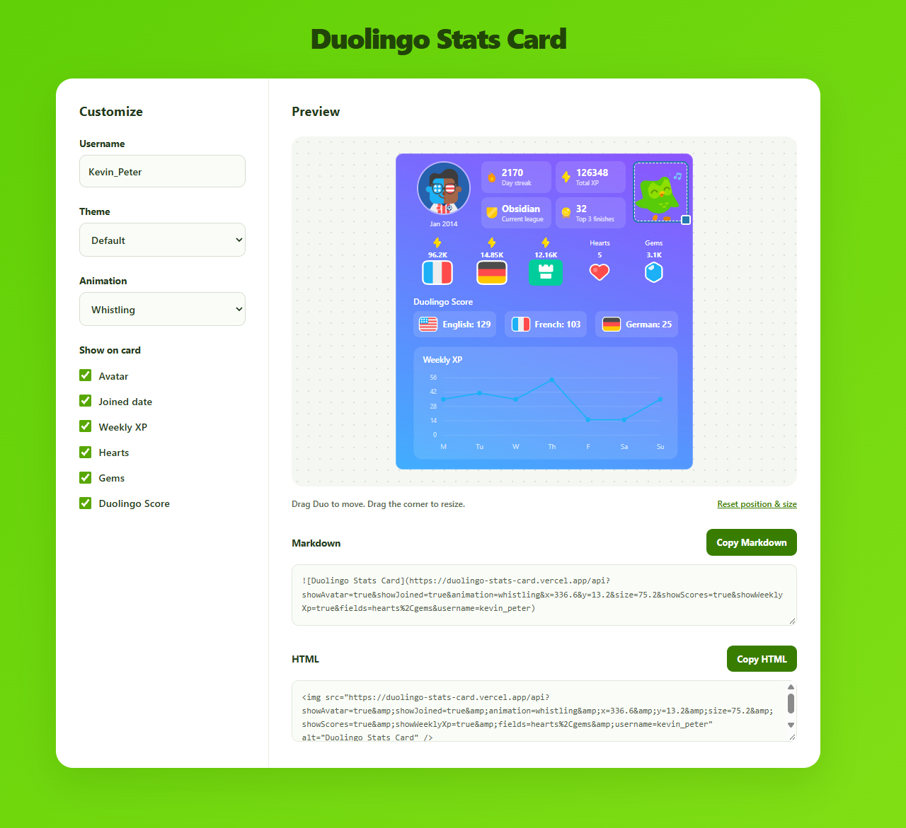

<a id="readme-top"></a>

<!-- PROJECT LOGO -->
<br />
<div align="center">
  <a href="https://github.com/KevzPeter/Duolingo-Stats-Card">
    
  </a>

  <h3 align="center">Duolingo Stats Card</h3>

  <p align="center">
    🦉 A real-time, customizable Duolingo widget that you can embed on your website or markdown files ✨
    <br />
    <br />
    <a href="https://duolingo-stats-card.vercel.app/">✨ View Demo</a>
    ·
    <a href="https://github.com/KevzPeter/duolingo-stats-card/issues">🐛 Report Bug</a>
    ·
    <a href="https://github.com/KevzPeter/duolingo-stats-card/issues">💁🏽 Request Feature</a>
  </p>
</div>

<br />

## 🚀 How to add to your page

<br/>

Use the [demo website](https://duolingo-stats-card.vercel.app/) to create your customized card! Add the following line to your Github README.md page / website / any markdown file and replace {your-duolingo-username}

```html

```

For example, if your Duolingo username is "John_Smith", add the following line (this is in Markdown mode):

```markdown

```

Want weekly XP, Duolingo scores, hearts, and gems? Deploy your own instance below.

<!--DEPLOYMENT-->

## 🚀 Deploy using Vercel

To access private Duolingo stats, like your Duolingo proficiency scores, gems, hearts, weekly XP etc, you will need to provide your Duolingo JWT Token. To keep your token secure, you will need to deploy your own Duolingo Stats Card.

<table>
  <tr>
    <th>Public stats</th>
    <th>Public + private stats</th>
  </tr>
  <tr>
    <td valign="top"></td>
    <td valign="top"></td>
  </tr>
</table>

1. Click **Fork** at the top of this repository, then **Create fork** to make a copy under your GitHub account.
2. Sign in to [Vercel](https://vercel.com/) with GitHub. Select **Add New → Project**, find your fork, and click **Import**. If it isn't listed, allow Vercel to access it through the GitHub permissions prompt.
3. Choose a project name, leave the detected **Next.js** settings as they are, and click **Deploy**. Wait for the deployment to finish.
4. Open your new project's **Settings → Environment Variables**. Add the variables below, selecting **Production** as the environment for each, and save. Get your token using the steps in the next section.

   | Name                | Value                                                                                           |
   | ------------------- | ----------------------------------------------------------------------------------------------- |
   | `DUOLINGO_JWT`      | Your Duolingo `jwt_token`. Treat this like a password.                                          |
   | `DUOLINGO_USERNAME` | Your Duolingo username, not your display name. It must belong to the same account as the token. |
   | `DUOLINGO_TIMEZONE` | Optional: your time zone, such as `America/Los_Angeles`. Leave it unset to use `UTC`.           |

5. Go to **Deployments**, open the latest production deployment's **⋯** menu, and select **Redeploy** so it picks up your saved variables.
6. Once it's ready, open the project's **Overview** and click its production domain. Your URL will look like `https://your-project-name.vercel.app` (Vercel may add a suffix if the name is taken). Use this address for your card builder and embeds.
   
7. In your deployed card builder, enter the username you configured, choose a theme and animation, and tick the fields you want to show. Drag Duo to position it and use its corner handle to resize it. Click **Copy Markdown** for a GitHub README or **Copy HTML** for a website, then paste the result into your page.

The copied code already includes your deployment's address and your selected options. To change your card later, reopen the same builder, customize it, and replace the old embed with the newly copied code. The extra stats checkboxes appear only for your configured username when both required variables are set.

### 🔑 Get your Duolingo JWT

1. Sign in to [Duolingo](https://www.duolingo.com/) in your browser.
2. Right-click the page and select **Inspect** to open developer tools.
3. Open **Application** (Chrome/Edge) or **Storage** (Firefox), expand **Cookies**, and select `https://www.duolingo.com`.
4. Find `jwt_token` and copy its **Value** into the `DUOLINGO_JWT` setting in Vercel. Don't copy the cookie name or share the value.

When the token expires, repeat these steps, update the saved value in Vercel, and redeploy from **Deployments → ⋯ → Redeploy**.

## 🎨 Themes

Want to spice up the look and feel of your stats card?
You can choose your favorite among 15 different themes!

Simply add the _theme_ parameter to the url like so:

```html

```

> [!NOTE]
> If you don't specify a theme, it would be rendered like how it's displayed at the top of this doc!

|                                           |                                                          |                                           |
| :---------------------------------------: | :------------------------------------------------------: | :---------------------------------------: |
|          `light` ![light][light]          |                   `dark` ![dark][dark]                   | `github-dark` ![github-dark][github-dark] |
|       `monokai` ![monokai][monokai]       |          `tokyonight` ![tokyonight][tokyonight]          |     `nightowl` ![nightowl][nightowl]      |
|       `onedark` ![onedark][onedark]       | `shades-of-purple` ![shades-of-purple][shades-of-purple] |       `dracula` ![dracula][dracula]       |
|       `cobalt2` ![cobalt2][cobalt2]       |                    `sky` ![sky][sky]                     |          `beach` ![beach][beach]          |
| `purple-gang` ![purple-gang][purple-gang] |                   `mint` ![mint][mint]                   |          `leafy` ![leafy][leafy]          |

[light]: https://duolingo-stats-card.vercel.app/api?username=Kevin_Peter&theme=light
[dark]: https://duolingo-stats-card.vercel.app/api?username=Kevin_Peter&theme=dark
[github-dark]: https://duolingo-stats-card.vercel.app/api?username=Kevin_Peter&theme=github-dark
[monokai]: https://duolingo-stats-card.vercel.app/api?username=Kevin_Peter&theme=monokai
[tokyonight]: https://duolingo-stats-card.vercel.app/api?username=Kevin_Peter&theme=tokyonight
[nightowl]: https://duolingo-stats-card.vercel.app/api?username=Kevin_Peter&theme=nightowl
[onedark]: https://duolingo-stats-card.vercel.app/api?username=Kevin_Peter&theme=onedark
[shades-of-purple]: https://duolingo-stats-card.vercel.app/api?username=Kevin_Peter&theme=shades-of-purple
[dracula]: https://duolingo-stats-card.vercel.app/api?username=Kevin_Peter&theme=dracula
[cobalt2]: https://duolingo-stats-card.vercel.app/api?username=Kevin_Peter&theme=cobalt2
[sky]: https://duolingo-stats-card.vercel.app/api?username=Kevin_Peter&theme=sky
[beach]: https://duolingo-stats-card.vercel.app/api?username=Kevin_Peter&theme=beach
[purple-gang]: https://duolingo-stats-card.vercel.app/api?username=Kevin_Peter&theme=purple-gang
[mint]: https://duolingo-stats-card.vercel.app/api?username=Kevin_Peter&theme=mint
[leafy]: https://duolingo-stats-card.vercel.app/api?username=Kevin_Peter&theme=leafy

### 💻 Run locally

Use Node.js 22+ and pnpm 10.30.3. For owner stats, copy `.env.example` to `.env.local`
and fill in your variables before starting the server. Keep `.env.local` out of commits.

```sh
pnpm install --frozen-lockfile
pnpm dev
```

Open [localhost:3000](http://localhost:3000). Restart the server after changing environment variables.

<!-- CONTRIBUTING -->

## 🙌🏼 Contributing

If you wanna add your custom theme or suggest enhancements, please fork the repo and create a pull request. You can also simply open an issue with the tag "enhancement".
Don't forget to give the project a star! Thanks again!

1. Fork the Project
2. Create your Feature Branch (`git checkout -b feature/AmazingFeature`)
3. Commit your Changes (`git commit -m 'Add some AmazingFeature'`)
4. Push to the Branch (`git push origin feature/AmazingFeature`)
5. Open a Pull Request

<p align="right">(<a href="#readme-top">back to top</a>)</p>

<!-- MARKDOWN LINKS & IMAGES -->
<!-- https://www.markdownguide.org/basic-syntax/#reference-style-links -->

[Next.js]: https://img.shields.io/badge/next.js-000000?style=for-the-badge&logo=nextdotjs&logoColor=white
[Next-url]: https://nextjs.org/
[React.js]: https://img.shields.io/badge/React-20232A?style=for-the-badge&logo=react&logoColor=61DAFB
[React-url]: https://reactjs.org/
[Duolingo]: https://img.shields.io/badge/Duolingo-%234DC730.svg?style=for-the-badge&logo=Duolingo&logoColor=white
[Duolingo-url]: https://duolingo.com/
